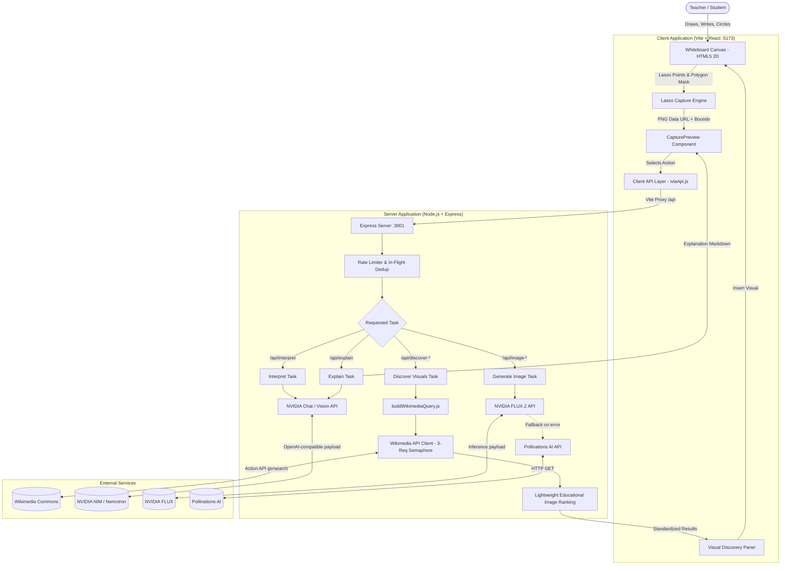

# IVLA — Interactive Visual Learning Assistant

An intelligent digital whiteboard built for educators and learners that blends freehand drawing tools with AI-driven visual interpretation, automated conceptual explanations, Wikimedia Commons educational visual discovery, and generative illustration.

---

## Table of Contents

- [Project Overview](#project-overview)
  - [Problem Statement](#problem-statement)
  - [Solution](#solution)
  - [Target Audience](#target-audience)
  - [Key Objectives](#key-objectives)
- [Features](#features)
  - [Whiteboard Canvas & Manipulation Engine](#whiteboard-canvas--manipulation-engine)
  - [AI Selection Lasso & Region Capture](#ai-selection-lasso--region-capture)
  - [Vision & Concept Interpretation](#vision--concept-interpretation)
  - [Educational Conceptual Explanations](#educational-conceptual-explanations)
  - [Wikimedia Commons Visual Discovery](#wikimedia-commons-visual-discovery)
  - [Generative AI Illustrations (FLUX.2 & Pollinations)](#generative-ai-illustrations-flux2--pollinations)
  - [Resilience, Rate Limiting & Quota Tracking](#resilience-rate-limiting--quota-tracking)
- [Screenshots & Demo](#screenshots--demo)
- [Technology Stack](#technology-stack)
- [Project Architecture](#project-architecture)
  - [Architecture Flow Diagram](#architecture-flow-diagram)
  - [Component Communication](#component-communication)
- [Folder Structure](#folder-structure)
- [Prerequisites](#prerequisites)
- [Installation and Setup](#installation-and-setup)
  - [1. Clone Repository](#1-clone-repository)
  - [2. Install Dependencies](#2-install-dependencies)
  - [3. Configure Environment Variables](#3-configure-environment-variables)
  - [4. Start Application in Development Mode](#4-start-application-in-development-mode)
  - [5. Independent Service Startup (Optional)](#5-independent-service-startup-optional)
- [Environment Variables](#environment-variables)
- [Running the Project](#running-the-project)
  - [Available Scripts](#available-scripts)
  - [Verification & Probe Test Scripts](#verification--probe-test-scripts)
- [API Documentation](#api-documentation)
  - [Health & Diagnostics](#health--diagnostics)
  - [Interpretation & Explanation Endpoints](#interpretation--explanation-endpoints)
  - [Visual Discovery (Wikimedia Commons)](#visual-discovery-wikimedia-commons)
  - [AI Illustration Generation](#ai-illustration-generation)
  - [Standardized Error Response](#standardized-error-response)
- [Database Documentation](#database-documentation)
- [Application Workflow](#application-workflow)
  - [Workflow 1: Circling Board Content for Wikimedia Discovery](#workflow-1-circling-board-content-for-wikimedia-discovery)
  - [Workflow 2: Generating Text Explanation & Board Placement](#workflow-2-generating-text-explanation--board-placement)
  - [Workflow 3: Fallback Custom AI Illustration](#workflow-3-fallback-custom-ai-illustration)
  - [Workflow 4: Type-Instead Workflow](#workflow-4-type-instead-workflow)
- [Testing](#testing)
- [Troubleshooting](#troubleshooting)
- [Deployment](#deployment)
  - [Production Client Build](#production-client-build)
  - [Backend Deployment](#backend-deployment)
- [Contributing](#contributing)
- [Roadmap & Future Improvements](#roadmap--future-improvements)
- [License and Acknowledgements](#license-and-acknowledgements)
- [Author & Contact](#author--contact)

---

## Project Overview

### Problem Statement
During classroom and remote lessons, instructors frequently sketch concepts, write equations, or draw diagrams on whiteboards. When students struggle with a topic, instructors must either spend time hand-drawing complex diagrams from scratch, navigate away from the lesson to search Google or Wikipedia, or struggle to find licensed, high-resolution educational assets that fit the whiteboard context.

### Solution
**IVLA (Interactive Visual Learning Assistant)** transforms the traditional whiteboard into an intelligent teaching surface. Teachers draw or write naturally on the digital canvas, circle any region of interest using the **AI Circle** tool, and IVLA instantly:
1. Interprets handwriting, equations, and sketches using multimodal vision reasoning.
2. Discovers accurate, high-resolution educational diagrams directly from **Wikimedia Commons** with complete attribution and licensing metadata.
3. Formulates classroom-ready explanations, real-world examples, and comprehension check questions tailored to specific grade levels.
4. Generates custom illustrations using generative diffusion models when no existing diagram suffices.
5. Inserts selected visual cards or text elements seamlessly back onto the whiteboard as interactive canvas elements.

### Target Audience
- **K-12 and Higher Education Teachers**: Enhancing classroom explanations on interactive displays, tablets, or laptops.
- **Tutors and Online Instructors**: Sharing real-time instructional diagrams during screen shares.
- **Students & Self-Learners**: Whiteboarding study concepts with real-time conceptual guidance and diagrams.

### Key Objectives
- **Zero Friction**: Eliminate context switching away from the active teaching canvas.
- **Graceful Offline & Unconfigured Operation**: Canvas drawing, manipulation, and Wikimedia search work without requiring proprietary AI credentials.
- **Responsible Licensing**: Every external visual brought onto the canvas preserves its Wikimedia Commons creator, license type, and original repository links.
- **Safety & Cost Control**: In-flight deduplication, strict concurrency semaphores, per-request budget bounds, and rate limiters prevent API runaway costs and rate limit violations.

---

## Features

### Whiteboard Canvas & Manipulation Engine
- **Typed Element Architecture**: The board state is modeled as an immutable list of typed objects (`stroke`, `shape`, `text`, `image`) rather than flat pixel bitmaps.
- **Freehand Pen**: Quadratic midpoint curve smoothing with stylus pressure sensitivity.
- **Shapes**: High-precision rendering of rectangles, ellipses, straight lines, and directional arrows.
- **Color & Stroke Controls**: Multi-swatch color selector and variable stroke thickness slider.
- **Select & Transform Tool**: Bounding-box hit detection to select elements, drag to reposition, and delete.
- **Undo / Redo History**: 100-step history stack supporting standard keyboard shortcuts (`Ctrl+Z`, `Ctrl+Y`, `Ctrl+Shift+Z`).
- **Board Clear**: Modal confirmation dialog preventing accidental canvas wipes with full undo recovery.

### AI Selection Lasso & Region Capture
- **AI Circle Tool**: Freehand lasso with marching-ants SVG overlay.
- **Region Validation**: Enforces minimum enclosed boundary thresholds to prevent accidental clicks.
- **Polygon Masking**: Canvas 2D composite clip masks elements strictly within the lasso boundary against a white background, generating an optimized PNG base64 data URL.
- **Adaptive Card Placement**: Contextual dialogue card positioning beneath or alongside the circled region, staying within viewport bounds.

### Vision & Concept Interpretation
- **Multimodal Vision Ingestion**: Sends the masked whiteboard crop to NVIDIA's reasoning vision model (`nvidia/nemotron-3.5-super-vl-120b-a12b`).
- **Structured JSON Extraction**: Parses transcriptions, primary subject, core concepts, key terms, and visual elements.
- **Tolerant Parsing & Low-Confidence Safeguards**: Strips markdown code blocks, extracts isolated JSON substrings, and gracefully falls back to editable text prompts if the content is ambiguous.

### Educational Conceptual Explanations
- **Grade-Level Adaptation**: Configurable grade-level tuning (`auto`, `primary`, `middle`, `high`, `college`), persisted in browser `localStorage`.
- **Pedagogical Structure**: Generates clear, age-appropriate conceptual explanations, real-world application examples, and quick comprehension check questions.
- **Add to Board**: Teachers can commit generated explanation text directly onto the canvas as editable, selectable text columns.

### Wikimedia Commons Visual Discovery
- **Primary Visual Discovery Engine**: Integrates directly with the MediaWiki Action API (`commons.wikimedia.org/w/api.php`) without requiring API keys or OAuth authentication.
- **Targeted Query Formulation**: Converts Nemotron's vision output into focused search queries prioritizing diagrams, cross-sections, and educational schematics.
- **Lightweight Educational Ranking**: Scores and filters candidate media by format (SVG and PNG prioritized over bitmaps), image resolution, keyword proximity, and presence of educational qualifiers while filtering out non-diagram noise (portraits, coins, monuments, and PDFs).
- **Attribution & Metadata Preservation**: Extracts thumbnail URLs, original high-res image URLs, description pages, creator credit, and license names (`CC BY-SA`, `CC0`, `Public domain`).
- **One-Click Canvas Insertion**: Inserts chosen Commons diagrams directly into the canvas at proportional dimensions, retaining creator and license metadata.

### Generative AI Illustrations (FLUX.2 & Pollinations)
- **Secondary Creative Fallback**: Available when abstract concepts lack pre-existing diagrams or when custom pedagogical art is desired.
- **Prompt Synthesis**: Translates detected concepts into detailed educational art prompts (`buildImagePrompt.js`).
- **Dual-Provider Resilience**: Requests image generation from NVIDIA FLUX.2 Klein 4B (`black-forest-labs/flux.2-klein-4b`); automatically falls back to Pollinations AI on service unavailability or quota exhaustion.

### Resilience, Rate Limiting & Quota Tracking
- **Wikimedia Concurrency & Rate Limiting**: Internal 3-request semaphore, automatic handling of HTTP 429/503 `Retry-After` headers, and custom user-agent identification.
- **In-Flight Deduplication & LRU Cache**: Memory cache storing up to 50 items; duplicate concurrent requests share single outbound promises to prevent double-click token waste.
- **Session Usage Counter**: Endpoint `/api/usage` tracks session call counts.
- **Strict Outbound Call Budget**: Enforces a maximum cap (4 calls per click) across retries to prevent unbounded billable loops.

---

## Screenshots & Demo

> *Note: Pre-recorded demo animations and screenshots are currently maintained externally. Below is an overview of the key visual interfaces:*

| Interface Component | Description |
| :--- | :--- |
| **Whiteboard Canvas** | Infinite-feel white drawing canvas with bottom-centered floating dock. |
| **Tool Dock** | Tools: Select, Pen, Eraser, Shapes (Rect, Ellipse, Line, Arrow), AI Circle, Other (Palette/Width), Undo, Redo, Clear. |
| **Capture Preview Card** | Floats beside the circled content with options to **Find visual** (Commons) or **Explain** (Text). |
| **Visual Discovery Panel** | 2x2 grid displaying 4 top-ranked Wikimedia Commons diagrams, license tags, author credits, Commons page links, and "Insert" buttons. |
| **Whiteboard Inserted Element** | Rescaled visual diagram placed adjacent to the circled concept, selectable and moveable. |

---

## Technology Stack

### Frontend
| Technology | Version / Spec | Role in IVLA |
| :--- | :--- | :--- |
| **React** | `^18.3.1` | User interface, state management, and component lifecycle. |
| **Vite** | `^5.4.11` | Frontend build tooling, Hot Module Replacement (HMR), and API proxy. |
| **HTML5 Canvas API** | Native Canvas 2D | Low-latency whiteboard rendering, custom stroke smoothing, and element drawing. |
| **Pointer Events API** | Native DOM | Multi-input handling (stylus pressure, touch, and mouse input). |
| **Lucide React** | `^0.469.0` | Accessible toolbar, status, and navigation icons. |

### Backend
| Technology | Version / Spec | Role in IVLA |
| :--- | :--- | :--- |
| **Node.js** | `>= 18` (Verified on `v24.16.0`) | Backend JavaScript runtime environment. |
| **Express** | `^4.21.2` | REST API routing and middleware management. |
| **CORS** | `^2.8.5` | Cross-Origin Resource Sharing middleware. |
| **express-rate-limit** | `^8.7.0` | IP-based request throttling on AI routes. |
| **dotenv** | `^18.0.1` | Environment variable management from `.env`. |

### Database
- **No external database required**: IVLA is intentionally architected as a lightweight, privacy-first teaching tool. Whiteboard state lives in-memory on the client, and server-side caches use an in-process LRU cache.

### Authentication & Security
- **No user authentication required**: Runs without requiring user logins.
- **Server-Side API Key Isolation**: Proprietary NVIDIA keys remain on the Node backend; client code never has access to credentials.

### APIs & External Integrations
| Service | Purpose | Authentication |
| :--- | :--- | :--- |
| **Wikimedia Commons (MediaWiki Action API)** | Primary educational diagram search, ranking, and retrieval. | **None** (Public API, custom User-Agent). |
| **NVIDIA Cloud Functions / NIM API** | Vision analysis (`nemotron-3.5-super-vl`), explanations, and image generation (`flux.2-klein-4b`). | Bearer API Key (`NVIDIA_API_KEY`). |
| **Pollinations AI** | High-availability fallback image generator. | **None** (Public GET API). |

---

## Project Architecture

### Architecture Flow Diagram



### Component Communication
1. **Client to Server**: The Vite client communicates with the backend Express server via a reverse proxy configured in [`client/vite.config.js`](file:///home/akshit/Documents/IVLA/client/vite.config.js) mapping `/api/*` to `http://localhost:3001`.
2. **Backend to Wikimedia**: The backend executes HTTP queries against Wikimedia Commons Action API using a 3-concurrency semaphore, parses image extensions, runs lightweight ranking heuristics, and returns a normalized JSON response.
3. **Backend to NVIDIA NIM**: Outbound calls to `https://integrate.api.nvidia.com/v1/chat/completions` pass base64 image data URLs for vision reasoning and return strictly structured JSON.

---

## Folder Structure

```
IVLA/
├── .env.example                     # Environment template for server configuration
├── package.json                     # Root orchestrator (npm run dev, install:all)
├── README.md                        # Project documentation
│
├── client/                          # Frontend React + Vite application
│   ├── index.html                   # HTML entry point with system fonts
│   ├── package.json                 # Frontend dependencies (React, Lucide)
│   ├── vite.config.js               # Vite config with backend API proxy
│   └── src/
│       ├── main.jsx                 # React root rendering
│       ├── App.jsx                  # Main application state & whiteboard container
│       ├── App.css                  # Modern UI styles, animations & responsive dock
│       ├── api/
│       │   └── ivlaApi.js           # Client API layer & error normalization
│       ├── board/
│       │   ├── elements.js          # Typed element factory, bounding boxes, text layout
│       │   ├── renderer.js          # Canvas 2D render pipeline & image cache
│       │   ├── lasso.js             # Lasso polygon point capture & crop mask
│       │   ├── hitTest.js           # Bounding-box hit detection for selection
│       │   └── history.js           # 100-step immutable undo/redo history stack
│       └── components/
│           ├── WhiteboardCanvas.jsx # Interactive canvas component with pointer handlers
│           ├── Toolbar.jsx          # Bottom floating action dock & tool controls
│           ├── CapturePreview.jsx   # Contextual dialog card for AI actions
│           └── VisualDiscoveryPanel.jsx # Wikimedia Commons image results grid
│
└── server/                          # Backend Express application
    ├── index.js                     # Server entry point & middleware initialization
    ├── package.json                 # Backend dependencies (Express, CORS, rate-limit)
    ├── .env                         # Local environment variables (not committed)
    ├── .env.example                 # Environment template
    ├── config/
    │   └── models.js                # AI model IDs & external endpoint URLs
    ├── prompts/
    │   ├── interpret.js             # Vision reader prompt for whiteboard crop
    │   ├── explain.js               # Pedagogical explanation prompt by grade level
    │   └── imagePrompt.js           # Visual description prompt generator
    ├── tasks/
    │   ├── interpret.js             # Vision interpretation task execution
    │   ├── explain.js               # Explanation task execution
    │   ├── buildWikimediaQuery.js   # Generates targeted educational search queries
    │   ├── discoverVisuals.js       # Orchestrates Commons search and ranking
    │   ├── buildImagePrompt.js      # Synthesizes prompt for generative models
    │   └── generateImage.js         # Dispatches FLUX.2 with Pollinations fallback
    ├── providers/
    │   ├── wikimedia.js             # MediaWiki API client, semaphore & ranking engine
    │   ├── nvidiaChat.js            # NVIDIA OpenAI-compatible chat/vision client
    │   ├── nvidiaImage.js           # NVIDIA FLUX image generation provider
    │   ├── pollinations.js          # Fallback image generation provider
    │   ├── withRetry.js             # Exponential backoff retry handler
    │   └── AiError.js               # Typed application error abstractions
    ├── lib/
    │   ├── cache.js                 # In-memory SHA-256 LRU cache (50 entries)
    │   ├── rateLimit.js             # Express rate limiter configuration
    │   ├── budget.js                # Per-click outbound call budget enforcer
    │   ├── usage.js                 # In-memory session API call counter
    │   ├── validate.js              # Request payload validators
    │   └── parseJson.js             # Resilient loose JSON parser & normalizers
    └── scripts/
        ├── smoke.js                 # Live end-to-end quota validation test
        ├── probe-wikimedia-eval.js  # Phase 9 validation probe for Wikimedia discovery
        ├── probe-wikimedia.js       # Standalone query & retrieval probe
        ├── probe-step1.js           # Unit probe: Retry & validation checks
        ├── probe-step2.js           # Unit probe: JSON parsing & budget checks
        ├── probe-step3.js           # Unit probe: Explanation normalizer checks
        ├── probe-step4.js           # Unit probe: In-memory cache & dedup checks
        └── probe-step7.js           # Unit probe: Image extraction & prompt cleaning
```

---

## Prerequisites

Before setting up IVLA, ensure your system meets the following prerequisites:

- **Node.js**: Version `18.x` or higher (verified on Node `v24.16.0`).
- **npm**: Version `9.x` or higher (verified on npm `11.13.0`).
- **NVIDIA API Key** *(Optional)*: Required only for Nemotron vision interpretation and FLUX.2 image generation. Get an API key from [NVIDIA Build](https://build.nvidia.com).
- **Web Browser**: Modern Chromium, Firefox, or Safari browser with HTML5 Canvas and Pointer Events support.

---

## Installation and Setup

### 1. Clone Repository
```bash
git clone git@github.com:akshitsingh13/IVLA.git
cd IVLA
```

### 2. Install Dependencies
Run the root setup command to install dependencies across the root, client, and server workspaces:
```bash
npm run install:all
```

*Alternatively, install each workspace manually:*
```bash
npm install
npm install --prefix client
npm install --prefix server
```

### 3. Configure Environment Variables
Copy the `.env.example` file to create `server/.env`:
```bash
cp .env.example server/.env
```

Open `server/.env` in your editor and configure your environment:
```ini
PORT=3001
NVIDIA_API_KEY=nvapi-your-key-here
```
*(If you do not have an NVIDIA key, leave it empty or commented out. Whiteboard drawing and Wikimedia Commons discovery will still work seamlessly.)*

### 4. Start Application in Development Mode
From the root repository directory, start both the client and server concurrently:
```bash
npm run dev
```

- **Frontend Client**: Open [http://localhost:5173](http://localhost:5173)
- **Backend API**: Running on [http://localhost:3001](http://localhost:3001)
- **Backend Health Check**: [http://localhost:3001/api/health](http://localhost:3001/api/health)

### 5. Independent Service Startup (Optional)
If you prefer running services in separate terminal sessions:

**Terminal 1 (Backend Server):**
```bash
cd server
npm run dev
```

**Terminal 2 (Frontend Client):**
```bash
cd client
npm run dev
```

---

## Environment Variables

All environment variables are loaded by the backend server via `server/.env`:

| Variable Name | Required | Default | Description |
| :--- | :---: | :---: | :--- |
| `PORT` | Optional | `3001` | Local port for Express API server. |
| `NVIDIA_API_KEY` | Optional | *Empty* | NVIDIA Cloud Functions API key starting with `nvapi-`. Required for vision interpretation and FLUX.2 image generation. |
| `SMOKE_BASE` | Optional | `http://localhost:3001` | Base URL used exclusively by the `server/scripts/smoke.js` test script. |
| `NVIDIA_BASE_URL`| Optional | `https://integrate.api.nvidia.com/v1` | Override endpoint used for internal testing/mocking in `probe-models.js`. |

---

## Running the Project

### Available Scripts

#### Root Directory (`/`)
- `npm run dev`: Runs both client (`:5173`) and server (`:3001`) simultaneously using `concurrently`.
- `npm run install:all`: Installs npm dependencies across root, `client/`, and `server/`.
- `npm run build`: Compiles production assets for the client into `client/dist/`.
- `npm run start`: Starts the Express backend server directly (`node server/index.js`).

#### Client Directory (`/client`)
- `npm run dev`: Starts the Vite development server with HMR on port `5173`.
- `npm run build`: Compiles optimized production bundle into `client/dist/`.
- `npm run preview`: Previews the production build locally.

#### Server Directory (`/server`)
- `npm run dev` or `npm start`: Starts the Express server (`node index.js`).

### Verification & Probe Test Scripts
The project includes a suite of standalone, deterministic probes in `server/scripts/` to verify modules without consuming API credits:

```bash
# 1. Verify Wikimedia Commons Visual Discovery & 5 Key Educational Topics (Free, uses public API)
node server/scripts/probe-wikimedia-eval.js

# 2. Verify Retry handler & input validators (18 checks, offline)
node server/scripts/probe-step1.js

# 3. Verify Resilient JSON parser & outbound call budget (13 checks, offline)
node server/scripts/probe-step2.js

# 4. Verify Explanation normalizer (4 checks, offline)
node server/scripts/probe-step3.js

# 5. Verify In-memory cache & concurrent request deduplication (6 checks, offline)
node server/scripts/probe-step4.js

# 6. Verify Image extraction & prompt cleaning (18 checks, offline)
node server/scripts/probe-step7.js

# 7. Live end-to-end smoke test (Caution: Spends ~4 NVIDIA API credits if key is configured)
node server/scripts/smoke.js
```

---

## API Documentation

All backend API routes are prefixed under `/api`.

### Health & Diagnostics

#### `GET /api/health`
Checks whether the Express server is online and operational.
- **Request**: No parameters.
- **Response** (`200 OK`):
  ```json
  { "ok": true }
  ```

#### `GET /api/usage`
Returns the count of NVIDIA API calls performed during the current server session.
- **Response** (`200 OK`):
  ```json
  { "nvidiaCalls": 3 }
  ```

---

### Interpretation & Explanation Endpoints

#### `POST /api/interpret`
Extracts structured concepts and text from a circled whiteboard crop using multimodal vision.
- **Request Body**:
  ```json
  {
    "imageDataUrl": "data:image/png;base64,iVBORw0KGgo...",
    "gradeLevel": "middle"
  }
  ```
- **Response** (`200 OK`):
  ```json
  {
    "interpretation": {
      "contentType": "diagram",
      "transcription": "H2O cycle",
      "concept": "Water cycle",
      "subject": "earth science",
      "keyTerms": ["evaporation", "precipitation", "condensation"],
      "visualElements": "Arrows showing evaporation from sea to clouds",
      "confidence": 0.95
    },
    "lowConfidence": false
  }
  ```

#### `POST /api/explain`
Generates an educational explanation, real-world example, and comprehension question for an interpreted concept.
- **Request Body**:
  ```json
  {
    "interpretation": {
      "concept": "Photosynthesis",
      "subject": "biology"
    },
    "gradeLevel": "middle"
  }
  ```
- **Response** (`200 OK`):
  ```json
  {
    "explanation": "Photosynthesis is the process where plants use sunlight, water, and carbon dioxide to make oxygen and energy in the form of sugar.",
    "example": "A houseplant on your windowsill absorbing sunlight to grow green leaves.",
    "checkQuestion": "What three things do plants need to start photosynthesis?"
  }
  ```

---

### Visual Discovery (Wikimedia Commons)

#### `POST /api/discover-from-image`
Interprets a whiteboard image crop (or accepts pre-cached interpretation) and searches Wikimedia Commons for ranked educational diagrams.
- **Request Body**:
  ```json
  {
    "imageDataUrl": "data:image/png;base64,...",
    "gradeLevel": "high",
    "limit": 4,
    "interpretation": { "concept": "Human heart", "subject": "biology" }
  }
  ```
- **Response** (`200 OK`):
  ```json
  {
    "interpretation": { "concept": "Human heart", "subject": "biology" },
    "lowConfidence": false,
    "query": "Human heart anatomical cross-section diagram",
    "results": [
      {
        "id": "commons_26394292",
        "title": "Diagram of the human heart.svg",
        "thumbnailUrl": "https://thumb.wikimedia.org/wikipedia/commons/thumb/0/03/Diagram_of_the_human_heart.svg/800px-Diagram_of_the_human_heart.svg.png",
        "imageUrl": "https://upload.wikimedia.org/wikipedia/commons/0/03/Diagram_of_the_human_heart.svg",
        "pageUrl": "https://commons.wikimedia.org/wiki/File:Diagram_of_the_human_heart.svg",
        "width": 659,
        "height": 640,
        "creator": "Wapcaplet",
        "license": "CC BY-SA 3.0",
        "licenseUrl": "https://creativecommons.org/licenses/by-sa/3.0",
        "attribution": "Diagram of the human heart.svg by Wapcaplet (CC BY-SA 3.0)",
        "source": "Wikimedia Commons"
      }
    ],
    "totalFound": 6
  }
  ```

#### `POST /api/discover-from-text`
Discovers Wikimedia Commons visuals directly from a typed concept without requiring an image capture.
- **Request Body**:
  ```json
  {
    "text": "Binary search",
    "gradeLevel": "college",
    "limit": 4
  }
  ```
- **Response** (`200 OK`): Standardized visual discovery result payload matching the format above.

---

### AI Illustration Generation

#### `POST /api/image-from-image`
Generates a custom synthetic illustration from an image crop using FLUX.2 (with Pollinations fallback).
- **Request Body**:
  ```json
  {
    "imageDataUrl": "data:image/png;base64,...",
    "gradeLevel": "middle"
  }
  ```
- **Response** (`200 OK`):
  ```json
  {
    "interpretation": { "concept": "Gravity" },
    "lowConfidence": false,
    "imagePrompt": "A clean educational diagram illustrating gravity with an apple falling from a tree...",
    "imageDataUrl": "data:image/png;base64,...",
    "provider": "nvidia"
  }
  ```

#### `POST /api/image-from-text`
Generates a custom synthetic illustration from typed text input.
- **Request Body**:
  ```json
  {
    "text": "Water cycle",
    "gradeLevel": "primary"
  }
  ```
- **Response** (`200 OK`): Matching payload with generated `imageDataUrl` and `provider`.

---

### Standardized Error Response
When an error occurs, the server responds with a consistent JSON schema:
```json
{
  "error": {
    "code": "RATE_LIMIT",
    "message": "Too many requests. Please wait a moment and try again.",
    "canTypeInstead": true
  }
}
```

Common error codes: `BAD_INPUT`, `NOT_CONFIGURED`, `RATE_LIMIT`, `BUSY`, `NETWORK`, `BUDGET_EXCEEDED`, `BAD_RESPONSE`.

---

## Database Documentation

IVLA does **not** use a SQL or NoSQL database. 

- **Client Board State**: Stored in React state and managed by an in-memory undo/redo history stack (`createHistory` in `client/src/board/history.js`).
- **User Preferences**: The chosen grade level is persisted in the browser's `localStorage` (`ivla-grade`).
- **Server Cache**: Maintained in an in-memory LRU map (`server/lib/cache.js`) with a maximum capacity of 50 entries keyed by SHA-256 hashes of the request parameters.
- **Session Quota**: Stored in a lightweight in-memory counter (`server/lib/usage.js`).

---

## Application Workflow

### Workflow 1: Circling Board Content for Wikimedia Discovery
1. The instructor selects the **AI Circle** tool from the toolbar.
2. The instructor circles an illustration or handwriting (e.g., "Human Heart").
3. The client captures and masks the circled polygon, generating a clean white-background crop.
4. The **Capture Preview** card appears beside the selection with options to **Find visual** or **Explain**.
5. Clicking **Find visual** dispatches `/api/discover-from-image`.
6. The backend runs Nemotron vision reasoning, generates the search query `Human heart anatomical cross-section diagram`, and queries Wikimedia Commons.
7. Top-ranked diagrams are displayed in the **Visual Discovery Panel** with thumbnails, creator credit, and license badges.
8. The instructor clicks **Insert** on a diagram.
9. The visual is added to the whiteboard adjacent to the circled area at proportional dimensions.

### Workflow 2: Generating Text Explanation & Board Placement
1. With content circled, the instructor selects **Explain**.
2. The server interprets the concept and requests an educational explanation tailored to the selected grade level.
3. The result card displays the explanation, real-world example, and a comprehension check question.
4. The instructor clicks **Add to board**.
5. The explanation is wrapped and placed directly on the canvas as an interactive text element.

### Workflow 3: Fallback Custom AI Illustration
1. If Wikimedia Commons yields no suitable diagrams for an abstract concept, the instructor clicks **Generate custom image**.
2. The backend synthesizes an educational prompt and queries NVIDIA FLUX.2 Klein 4B.
3. If NVIDIA NIM is unreachable or unconfigured, the system automatically falls back to Pollinations AI.
4. The generated illustration is previewed in the card and can be inserted onto the canvas with one click.

### Workflow 4: Type-Instead Workflow
1. When no content is drawn, or if handwriting is difficult for the vision model to decipher, the user clicks **Type instead**.
2. The user inputs any topic (e.g., "Binary search algorithm").
3. The user can either find Commons visuals or generate text explanations without drawing anything on the board.

---

## Testing

IVLA employs modular testing scripts designed to verify subsystems independently:

### Running Test Scripts
All test scripts can be executed directly using Node.js:
```bash
# Evaluate Wikimedia Commons retrieval & ranking across 5 key educational topics
node server/scripts/probe-wikimedia-eval.js

# Test retry backoff and input validators
node server/scripts/probe-step1.js

# Test tolerant JSON parser & outbound call budget logic
node server/scripts/probe-step2.js

# Test explanation output normalizer
node server/scripts/probe-step3.js

# Test cache eviction & request deduplication
node server/scripts/probe-step4.js

# Test image extraction & prompt cleaning
node server/scripts/probe-step7.js
```

### Adding New Tests
- New probes should be placed in `server/scripts/` following the `probe-*.js` naming pattern.
- Probes should exit with code `0` on success and code `1` on assertion failure.
- Avoid network-dependent tests in unit probes unless testing an external integration specifically.

---

## Troubleshooting

### 1. `AI key: missing` on Server Startup
- **Symptom**: Terminal displays `[IVLA server] listening on http://localhost:3001` followed by `AI key: missing`.
- **Cause**: `server/.env` is missing or `NVIDIA_API_KEY` is empty.
- **Resolution**:
  1. Ensure `server/.env` exists (`cp .env.example server/.env`).
  2. Set `NVIDIA_API_KEY=nvapi-...` without quotation marks.
  3. Note: The whiteboard and Wikimedia Visual Discovery work completely without an API key.

### 2. Port Conflicts (`EADDRINUSE: 3001` or `5173`)
- **Symptom**: Server or client crashes on launch with `address already in use`.
- **Resolution**:
  - For server: Specify an alternative port via environment variable:
    ```bash
    PORT=3002 npm run dev
    ```
  - For client: Vite will automatically prompt to use the next available port (e.g., `5174`).

### 3. Missing Dependencies or Rollup Build Errors
- **Symptom**: `Rollup failed to resolve import "lucide-react"` or similar module error.
- **Resolution**: Ensure all nested package dependencies are installed by running:
  ```bash
  npm run install:all
  ```

### 4. Broken Images in Visual Discovery
- **Symptom**: An image card in the discovery panel displays "Image preview unavailable".
- **Resolution**: Certain Wikimedia Commons files use formats unsupported for direct web rasterization (e.g. multi-page DjVu). IVLA's ranking automatically filters these, and the UI provides a fallback placeholder while allowing the instructor to view the asset via the external "Page" link.

---

## Deployment

### Production Client Build
To build the frontend client for production:
```bash
npm run build
```
This generates optimized static HTML, CSS, and JavaScript bundles in `client/dist/`.

### Backend Deployment
1. Set production environment variables (`PORT`, `NVIDIA_API_KEY`, `NODE_ENV=production`).
2. Serve static client files directly from Express or place an NGINX / Cloudflare reverse proxy in front:
   ```javascript
   // Optional: Serve client build from Express in production
   app.use(express.static(path.join(__dirname, '../client/dist')));
   ```
3. Run the server using a process manager such as `pm2`:
   ```bash
   pm2 start server/index.js --name ivla-server
   ```

---

## Contributing

Contributions to IVLA are welcome! Follow these steps to contribute:

1. **Fork the Repository**: Create a personal fork on GitHub.
2. **Create a Feature Branch**:
   ```bash
   git checkout -b feature/your-feature-name
   ```
3. **Adhere to Code Conventions**:
   - Maintain clean modular architecture (keep board canvas logic separated from AI service tasks).
   - Never commit `.env` or hardcoded credentials.
   - Ensure elements added to the canvas adhere to the typed element schema in `client/src/board/elements.js`.
4. **Verify Functionality**:
   - Run the client build: `npm run build --prefix client`.
   - Run verification probes: `node server/scripts/probe-wikimedia-eval.js`.
5. **Submit a Pull Request**: Provide a clear description of changes, motivation, and test results.

---

## Roadmap & Future Improvements

Based on documented project notes and codebase comments:

- [ ] **Canvas Zoom & Pan**: Support navigation across an expanded whiteboard canvas area.
- [ ] **Multi-Image Canvas Selection**: Allow moving and grouping multiple whiteboard elements simultaneously.
- [ ] **Vector SVG Path Import**: Parse simple SVG vector paths directly into native whiteboard stroke elements.
- [ ] **Whiteboard Export**: Export board sessions to PNG, SVG, or PDF formats.
- [ ] **Session Persistence**: Optional local storage or file-based session saving and loading.

---

## License and Acknowledgements

### License
This repository currently does not include a standalone `LICENSE` file. All rights are reserved by the repository owner unless explicitly licensed otherwise. For open-source or institutional distribution inquiries, please contact the maintainer.

### Acknowledgements
- **Wikimedia Commons**: For providing access to an open repository of educational diagrams and media via the MediaWiki Action API.
- **NVIDIA NIM**: For powering multimodal vision reasoning (`nemotron-3.5-super-vl-120b-a12b`) and image generation (`flux.2-klein-4b`).
- **Pollinations AI**: For providing a resilient, free fallback for generative illustrations.
- **Lucide Icons**: For clean and accessible interface icons.

---

## Author & Contact

- **Author / Maintainer**: [Akshit Singh](https://github.com/akshitsingh13)
- **Repository**: [https://github.com/akshitsingh13/IVLA](https://github.com/akshitsingh13/IVLA)
